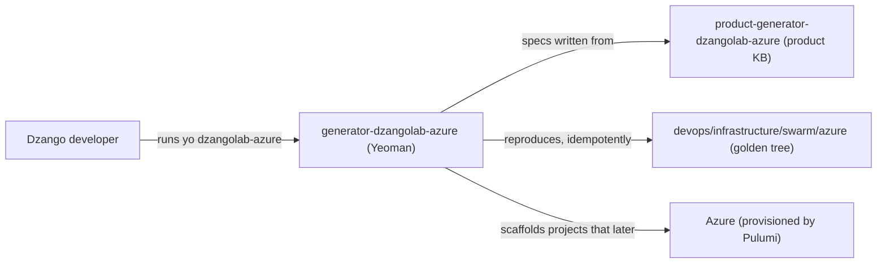
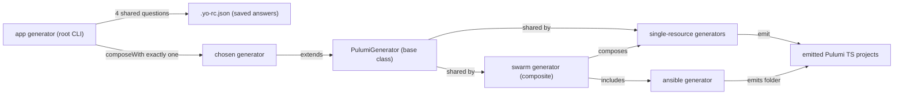

# Design — generator-dzangolab-azure

## Status

Draft, not yet reviewed. Depends on the [specs](../specs/index.md). Behaviour mirrors [generator-dzangolab-iac](https://github.com/dzangolab/generator-dzangolab-iac) except for the generator list and the grouped CLI prompt.

## Goal

A Yeoman generator that scaffolds Pulumi TypeScript projects (and an Ansible folder) to provision Azure resources and a Docker Swarm. The golden contract: running a generator with the same answers as an existing project under the production tree produces **no diff** — the generator is idempotent against `devops/infrastructure/swarm/azure`.

## Chosen architecture

One Yeoman package, one root `app` generator, one shared base class (`PulumiGenerator`), many thin subgenerators. A composite `swarm` generator composes the single-resource generators rather than emitting files itself.

### System context (C4 level 1)

### Containers (C4 level 2)

## Key design decisions

1. **Root `app` generator extends Yeoman's `Generator`, not `PulumiGenerator`.** It emits no project of its own; it asks the four shared answers once, saves them to `.yo-rc.json` via `this.config.save()`, then composes exactly one subgenerator with `composeWith`.

2. **Four shared answers, asked once.** Name, use-prefix, environment, generate-stack-config. Each subgenerator receives them through `_optionOrPrompt`, so nothing is asked twice. This mirrors iac's `app` generator exactly.

3. **Grouped list, not separators.** iac renders a flat list separated by `separator` lines and shows `undefined` for the group headings. Here the CLI renders a true grouped list — Docker, Pulumi, Other — so a group that holds no generator yet is simply hidden.

4. **`PulumiGenerator` is the shared base class.** It extends `Generator` and provides `_optionOrPrompt` (option value or prompt), plus the folder-name and default-project-name helpers. Every generator that emits a Pulumi project extends it.

5. **Templates are one folder per generator under `templates/<name>`.** Each is a Pulumi TypeScript project: `Pulumi.yaml`, `config.ts`, `index.ts`, `package.json`, `tsconfig.json`, `.env.example`, `.gitignore`, `README.md`, and an optional `Pulumi.stack.yaml`. Node generators additionally carry `nunjucks/` cloud-init templates. `writing()` uses `fs.copyTplAsync` with `globOptions.dot` so hidden files are emitted.

6. **Swarm is composite.** The `swarm` generator composes each single-resource generator in the collection and includes the Ansible folder; it does not copy each project's files itself. It asks shared questions (e.g. region) once and per-project questions once.

7. **Two generators pre-exist the swarm and are not composed by it:** `entra` (permissions group) and `pulumi-azure-backend` (state backend). See their specs.

## Data flow

1. Dev runs `yo dzangolab-azure`.
2. `app` prompts for the four shared answers, stores them (`this.config.set` + `this.config.save()`).
3. `app` shows the grouped list, dev picks one generator.
4. `app` calls `composeWith(chosen, { ...sharedAnswers, prefix })`, normalising the project name into a folder-safe prefix.
5. The chosen generator runs its own `prompting()` (via `_optionOrPrompt`) and `writing()` (via `copyTplAsync`) to emit files.
6. `swarm`, when chosen, repeats step 5 for each composed single-resource generator.

## Constraints and non-goals

- Idempotency against the golden tree is a hard acceptance criterion.
- `mvps-infra` is not the reference tree; unreviewed draft branches `feat/azure-swarm-leader` and `feat/azure-swarm-managers` on iac must be re-checked against the production tree.
- Out of scope for now: `ansible` and `pulumi-azure-backend` have no brief; `bastion`, `services`, `docs` folders are parked.
